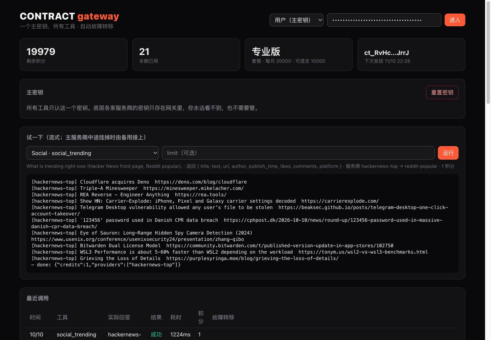
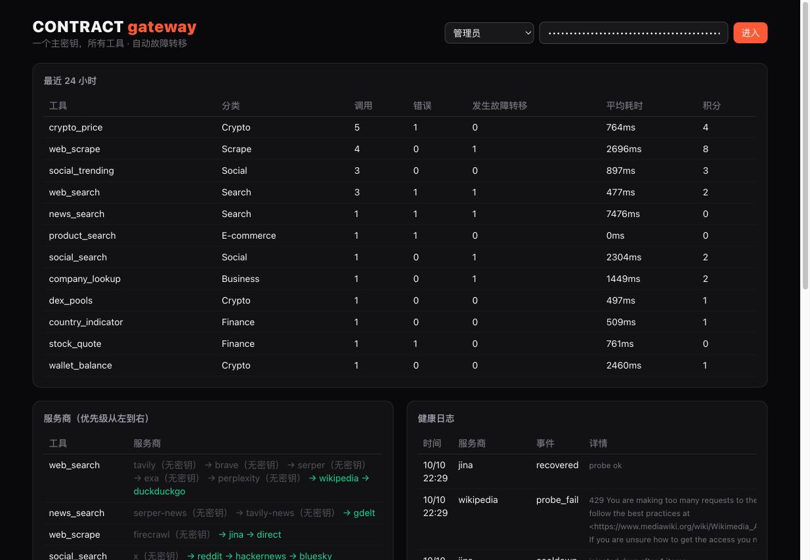

# Contract

**One master key for every tool your AI agent needs.** Search, scraping, social, crypto, finance, e-commerce and company data behind a single `ct_…` key. When a provider fails, the request moves to the next one, even halfway through a streamed response, and the agent never sees the error.

[中文说明](README.zh-CN.md)



- **One key.** Users get a `ct_` master key. Upstream credentials, auth schemes (Bearer, API key, signed requests), rate limits and billing stay inside the gateway.
- **Automatic failover.**
  - 5xx, 429, timeouts, network errors and broken upstream credentials all fail over to the next provider.
  - Failing providers cool down, a worker probes them, and they come back on their own.
- **Mid-stream failover.**
  - Results stream as items (a search hit, a Markdown paragraph, a quote).
  - If a provider dies mid-stream, the gateway resumes on the backup and skips what was already sent.
  - The client sees one complete stream that ends in `done`.
- **Plug and play over MCP.** `contract-mcp --key ct_…` works with Claude Code, Codex, Cursor, Gemini CLI, opencode, Claude Desktop, and any other MCP client.
- **Dynamic tool discovery.**
  - `tools/list` asks the gateway live, so new tools appear without updating clients.
  - `find_tools` searches the catalog by keyword or category.
- **Billing built in.** Plans (basic / pro / enterprise), credits with an overage limit, a per-transaction ledger, daily rollups, per-key rate limits, IP allowlists, and auto-blocking of IPs that keep sending bad keys.

**15 tools from 39 providers. 18 providers need no key, so it works out of the box.**

| Category | Tools | Providers (in failover order) |
|---|---|---|
| Search | `web_search`, `news_search` | Tavily → Brave → Serper → Exa → Perplexity → Wikipedia → DuckDuckGo · Serper News → Tavily News → GDELT |
| Scrape | `web_scrape` | Firecrawl → Jina Reader → direct fetch |
| Social | `social_search`, `social_trending`, `video_search` | X → Reddit → Hacker News → Bluesky · HN front page → Reddit popular · YouTube |
| Crypto | `crypto_price`, `dex_pools`, `wallet_balance` | CoinMarketCap → CoinGecko → DexScreener · DexScreener → GeckoTerminal · Etherscan → Chainbase → Blockscout |
| Finance | `stock_quote`, `macro_series`, `country_indicator`, `cn_stock_daily` | Finnhub → Alpha Vantage · FRED · World Bank · Tushare |
| E-commerce | `product_search` | eBay → Best Buy |
| Business | `company_lookup` | Crunchbase → Qichacha → OpenCorporates → GLEIF |

## Quick start

```sh
git clone https://github.com/zhixuanlucasfeng-cmyk/contract && cd contract
cp .env.example .env               # set ADMIN_TOKEN; add whichever provider keys you have
docker compose up -d --build       # postgres + redis + gateway (:8080) + worker
```

Open <http://localhost:8080>, choose **Admin**, enter `ADMIN_TOKEN`, and create a user. Their `ct_…` key is shown once.

```sh
claude mcp add contract -- node /path/to/contract/mcp/dist/index.js --key ct_… --url http://localhost:8080
```

You can also call it over plain HTTP:

```sh
curl -X POST localhost:8080/v1/tools/web_search/execute -H "authorization: Bearer ct_…" \
  -d '{"params":{"query":"model context protocol"},"stream":true}'
```



## Two editions

| | `lite/` | full (this folder) |
|---|---|---|
| Run | `node cli.mjs serve` | `docker compose up` |
| Storage | SQLite file | PostgreSQL + Redis |
| Tools | search + scrape | all 15 |
| Health state | in process | shared in Redis across instances |
| Background jobs | none | BullMQ: health probes, usage rollups, monthly credit grants |
| Dashboard | single HTML page | React + Tailwind, user and admin views |

## Docs

- [Architecture](docs/ARCHITECTURE.md): layers, data flow, the failover engine, tables, jobs.
- [Schema](db/schema.sql): every table.
- [Deploy & connect agents](docs/DEPLOY.md): config, HTTP API, error codes, MCP setup for each client.
- [Extend](docs/EXTEND.md): add a provider or a tool in a few lines.

These docs are written in Chinese; the code comments are in English.

## What it deliberately doesn't do

Contract only talks to official or public APIs. It has no account pools, no residential-proxy rotation and no browser-fingerprint spoofing, and it doesn't scrape platforms that have no open API. Add a licensed data provider as a normal provider when you need one.

## Test

```sh
cd gateway && npm test     # failover engine: 5xx, mid-stream death, no retry on 400, timeouts/cooldown, all-down
cd lite && npm test
# failover drills against a running gateway:
CONTRACT_FAULTS='{"jina":"drop:1","wikipedia":"500"}' docker compose up -d gateway
```

MIT License
